### IV.2.a) Mesures de cohérence
Afin de mesurer la dimension sémantique de notre corpus, nous utilisons l’allocation latente de Dirichlet. Comme expliqué dans notre partie sur la sémantique dans notre chapitre sur la formalisation de la tâche, cet algorithme détermine une modélisation des sujets couverts par un texte en fonction du nombre de sujets k prédéfini par l’utilisateur. La question du choix du paramètre k se pose alors. De plus, nous avons évoqué trois grandes problématiques qui affectent les analyses en NLP, soit le fléau de la dimensionnalité, les matrices clairsemées et finalement l’asymétrie de l’information.  Ces enjeux affectent le LDA, car c’est un modèle probabiliste qui s’appuie sur les probabilités de cooccurrence des mots dans des documents. De ce fait, nous devons regarder plusieurs modèles et voir comment les nettoyages de nos données impactent les résultats de nos modèles. Pour cela nous décidons d’itérer des modèles de LDA pour k∈{1,2,3,…,50} et de regarder plusieurs scores de performances. 
#### IV.2.a.i) PMI et NPMI
Le premier que l’on analyse est le score de cohérence Cv. Ce score propose de mesurer la cohérence des sujets modélisés en se basant sur la « Normalized Pointwise Mutual Information » (NPMI) (Syed et Spruit, 2017). La NPMI est la version normalisée de la « Pointwise Mutual Information » ou PMI, qui est une mesure qui permet de calculer la probabilité de deux mots d’apparaitre ensemble soit :

  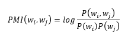

où P(w_i,w_j ) est la probabilité d’apparition conjointe des mots w_i et w_j et P(w_i ) et P(w_j) sont les probabilités indépendantes d’apparition pour les mots w_i et w_j. 
La NPMI permet d’obtenir un résultat compris entre 1 et -1 qui nous permet de regarder les différentes associations entre les mots sans prendre en compte la fréquence d’apparition de ces derniers, soit :

  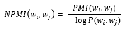

Dans le cadre du LDA, le score de cohérence Cv utilise le NPMI combiné à la distance cosine avec la fenêtre glissante booléenne pour évaluer la proximité entre les vecteurs de mots (Röder et al., 2015). Avec cette méthode, on veut évaluer la cohérence entre les mots qui compose les sujets en fonction de leurs distances les uns par rapport aux autres. La technique de fenêtre glissante, ou « sliding boolean window », permet de segmenter les textes afin de vérifier la présence de certains mots dans cette dernière. Cette mesure de cohérence est comprise entre -1 et 1, mais il est rare qu’elle soit négative. Afin de sélectionner un modèle, on cherche à maximiser le score Cv afin d’obtenir une meilleure distinction des sujets composés. Cependant, les chercheurs pointent plusieurs limites à ce score de cohérence. La première concerne la sensibilité au nombre de sujets k. En effet, Cv à tendance à favoriser les modèles avec un plus petit k, car ayant plus de probabilité de cooccurrence de mots. De plus, ce score a tendance à discriminer les sujets plus spécialisés au profit des sujets généraux avec des mots plus fréquemment utilisés à travers les sujets. Ainsi, il est important de souligner que la nature des données peut influencer le score de cohérence. Pour ces raisons, nous proposons d’y adjoindre une autre métrique de cohérence afin de nuancer les résultats que le Cv nous propose.  

#### IV.2.a.ii) Coherence Umass et CV
La deuxième métrique que nous prenons en compte est le score de cohérence Umass. Cette métrique s’appuie sur la cooccurrence des mots dans les documents du corpus de base afin de déterminer si les sujets composés sont cohérents et interprétables. Dans leurs articles de 2011, David Mimno et al. (David Mimno et al., 2011), propose la formule suivante pour définir Umass : 

  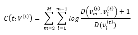

où t représente un sujet et , 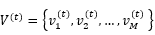
est un ensemble M de mots qui compose un sujet. Si on regarde le contenu de la fraction, 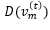 représente la fréquence du mot m dans le corpus de documents. Au numérateur on retrouve 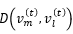 , qui représente la cooccurrence du mot « m » et du mot « l » dans le corpus de référence. Afin d’éviter d’obtenir un logarithme de 0, les auteurs ajoutent la constante 1. Ainsi, plus les mots cooccurrents dans le corpus, plus la valeur de Umass est proche de 0 et, réciproquement, moins ils cooccurrent, plus la valeur du score est négative. Donc, plus le score est faible et plus les sujets sont définis par des combinaisons de mots uniques qui les distinguent. Cette déduction est confirmée par l’article Farea et al (Farea et al., 2024), qui nous indique que, plus le score de cohérence est élevé, plus les sujets sont cohérents. L’avantage principal de ce score réside dans la vitesse de son calcul en comparaison du Cv. En revanche, ce score prend en compte la fréquence de cooccurrence dans les documents. Contrairement au score Cv qui s’appuie sur une fenêtre, ce score peut passer à côté de liens contextuels entre les mots du corpus. Ainsi, on peut constater que la performance de ces scores est très relative à la nature des données présentées. C’est pour l’ensemble de ces raisons que nous les interprétons conjointement pour éviter le plus possible de générer des biais de sélection dans notre analyse du paramètre k.
Si les scores de cohérences Cv et CUmass nous permettent de nous aider à la sélection de notre modèle, il est important de souligner que maximiser ces scores n’implique pas forcément que les sujets formés par le LDA sont interprétables et lisibles. Ayant manifesté l’importance d’avoir des analyses lisibles pour les professionnels, nous devons introduire un élément de lisibilité pour le choix de notre modèle. L’utilisation des deux scores a pour objectif d’affiner l’échantillon k à vérifier pour l’entrainement du LDA. Mais, la sélection finale du modèle s’appuie sur la lecture des sujets composés et l'interprétation que nous pouvons en faire. Cependant, le nettoyage de nos données est une partie essentielle dans le prétraitement du corpus. Or, ces scores ont une sensibilité à la taille et à la nature du vocabulaire. Nous utilisons cette propriété pour voir si nos nettoyages ont un effet sur le modèle ainsi que pour comparer les différents nettoyages de données les uns aux autres. En résumé, les éléments quantitatifs et qualitatifs doivent être pris en considération lors du choix de notre modèle. Cela permet d’assurer que nos sujets ainsi que la robustesse du modèle correspondent à nos besoins.

#### Iv.2.a.iii) Perplexité
La dernière métrique que nous utilisons pour évaluer notre LDA est la perplexité. Cette mesure est fondée sur la fonction de vraisemblance « likelihood » des documents pour le modèle de LDA à k sujets. En d’autres termes, cette mesure nous permet de voir à quel point ce modèle décrit précisément le corpus de document sur lequel il est utilisé (Blei et al., 2003). La bibliothèque Gensim sur python propose une version logarithmique de la mesure, car elle rend les résultats plus interprétables du fait de la diminution de l’échelle amenée par la fonction logarithme. Dans l’article « Latente Dirichlet Allocation », les chercheurs définissent la perplexité par la formule suivante :

  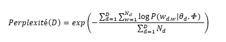

où D correspond à l’ensemble des documents du corpus, N_d est le nombre de mots dans le corpus et 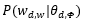 est la probabilité d’apparition du mot w en prenant en compte la distribution sujets-mot Φ de ce dernier ainsi que de la distribution sujet-document θ_d. De cela, on peut déduire le logarithme de la perplexité comme :

  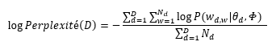

Dans ce cas, nous cherchons un score de perplexité faible qui nous indique un modèle que ce dernier est capable de s’ajuster aux données de notre corpus. Néanmoins, cela ne veut pas dire que le modèle avec la meilleure perplexité n’est pas victime de surapprentissage.  Les nettoyages peuvent faire augmenter le score de perplexité à cause du retrait de contexte que peuvent amener ces derniers. Dans notre cas, nous regardons cette métrique pour voir comment les différentes itérations de LDA s’adaptent à nos données.
Ces trois métriques nous permettent donc de mesurer la cohérence des sujets ainsi que la résilience des modèles sur notre corpus en fonction du paramètre k. cependant, on doit souligner la sensibilité de ces dernières à la variation de k. De ce fait, nous ne pouvons pas simplement choisir la valeur qui maximise nos résultats dans ces trois comme une méthode pour choisir le nombre de sujets. De ce fait, la méthode du coude de Cattell semble la plus adaptée pour affiner et définir le nombre optimal de k de nos modèles. Cette méthode consiste à détecter visuellement le ralentissement de la croissance ou de la décroissance des scores, ici en corrélation avec l’augmentation de K. Une fois notre échantillon de k à tester affiné, nous regardons de plus près manuellement les sujets formés par ces différents modèles de LDA. L’interprétabilité est au cœur de nos préoccupations. C’est pourquoi nous choisissons les vecteurs de mots composés par le LDA en fonction de notre capacité à les nommer et à les comprendre. Finalement, nous utilisons ces métriques pour voir si nos nettoyages ont un effet concret sur les performances du modèle. Cela nous aidant à ne pas trop diminuer la dimensionnalité de ce dernier tout en étudiant les différents scénarios.

### IV.2.b) Nettoyages et sélection du nombre de sujets 
Plutôt, nous avons évoqué l’importance de la diminution de dimensionnalité de nos données pour rendre le LDA plus efficace. À ces fins, nous observons plusieurs étapes de nettoyages dans l’objectif de regarder l’impact que ces étapes ont sur les mesures de performances ainsi que sur la lisibilité des sujets formés. Par conséquent, nous considérons quatre modèles à évaluer. 

#### IV.2.b.i) Modèle brut
Pour établir une base de comparaison, nous avons d’abord examiné un modèle que nous avons baptisé « brut ». Ce modèle n’a subi aucun nettoyage et contient de ce fait un grand nombre de variables. L’objectif de l’évaluation des performances de ce dernier est de nous donner une base pour voir si l’effet de nos prétraitements de nos données sur les résultats obtenus, nous le considérons comme notre expérience témoin. 

#### IV.2.b.ii) Modèle 1 : Normalisation 
Notre deuxième jeu de donnée est simplement normalisé. Cette étape consiste à mettre aux normes des différentes orthographes comme « Montreal » en « Montréal ». Une autre normalisation qui a été faite repose sur des termes médicaux. Au cours de notre exploration de données, nous avons eu l’occasion de lire les jugements fréquemment et avec l’analyse des bigrammes, nous avons remarqué l’apparition de symboles comme « l4-l5 » ou « C5-C6 ». À la lecture de notre corpus, nous avons remarqué que ces termes étaient des numéros de vertèbres ou de disques cervicaux. Nous avons décidé de les remplacer par « vertebreI, vertebreII, …, vertebreVII » et « cervicaleI, cervicaleII, …, cervicaleVII » pour les raisons que nous avons évoquées dans notre exploration de données. À cela, nous pouvons ajouter la suppression des numéros de dossiers présents dans les textes ainsi que la suppression des mots avec moins de trois lettres. Cet ensemble de nettoyages est réalisé en utilisant plusieurs modèles de regex qui nous permet de cibler des suites de caractères particuliers, ce qui permet de les remplacer ou de les supprimer.

#### IV.2.b.iii) Modèle 2 : Normalisation, lemmatisation, stopwords et nettoyage par fréquences
Notre troisième modèle reprend la normalisation et les nettoyages amenés par la normalisation des données, mais nous y ajoutons d’autres étapes pour diminuer la dimensionnalité. Nous commençons par lemmatiser le texte. La lemmatisation est un procédé qui permet de regrouper plusieurs mots de même forme dans leurs racines. Ce processus est commun en NLP et nous pouvons facilement l’implémenter à l’aide de la bibliothèque spacy pour python. À la suite de la lemmatisation, nous retirons une liste de stopwords, que nous avons déterminé avec une méthode heuristique. En effet, en regardant plusieurs résultats de LDA, nous avons vu que certains mots rendaient complexe la constitution de sujets distincts. Le cas le plus flagrant pour nous concerne le mot « exposition ». En effet, sans le retrait de ce dernier, nous avions régulièrement des sujets composés des mots : «exposition», «pulmonaire», «auditifs», «arthrose», «amiant», «surdité». Nous voyons dans nos annexes 15 et 16 que, malgré ces nettoyages avec les stopwords, la dissociation des sujets peut s’avérer complexe. Cependant, ce nettoyage permet tout de même de rendre les sujets plus lisibles, en particulier dans le cas des maladies. En ce qui concerne la confusion entre les maladies pulmonaires et auditives, notre intuition repose sur le fait que l’examen des cas de maladies professionnelles reliées à la surdité, aux maladies pulmonaires et à l’arthrose se base sur une exposition à certains risques. Ce qui est intéressant ici est l’idée que le même vocabulaire est utilisé par le tribunal pour parler de pathologies a priori différentes. Cela peut nous indiquer que l’examen logique effectué par le juge est similaire pour ces diverses affections. Cependant, nous avons estimé dans ce mémoire qu’il était préférable de conserver des sujets distincts en fonction des pathologies et nous avons retiré le mot du vocabulaire. Cette liste contient aussi des noms de tribunaux ou des abréviations qui n’apportent pas d’information importante à notre étude. Finalement, nous avons fait un nettoyage par fréquence pour réduire un peu plus la dimensionnalité. Ce nettoyage retire les mots présents moins de 100 fois dans le corpus et plus de 20 000 fois dans ce dernier. Pour effectuer cela, on regarde la distribution des mots dans le corpus en comptant la fréquence d’apparition des tokens. La communauté du NLP semble s’accorder sur le fait que le nettoyage par fréquence n’obéit qu’à une règle du pouce. Dans notre cas, pour choisir nos intervalles de coupes, nous avons utilisé un mélange de logique et de tâtonnements. Nous avons commencé par retirer 2% des tokens les plus fréquents et 5% des moins fréquents. Puis, nous avons augmenté progressivement le nettoyage en fonction des résultats que nous obtenions dans nos itérations de LDA. 

#### IV.2.b.iiii) Modèle 3 (modèle sélectionné): Normalisation, POS, lemmatisation, stopwords et nettoyage par fréquences
Finalement, notre dernier modèle ajoute un nettoyage en utilisant le « Part-of-speech » (POS tagging). Le POS tagging, permet d’identifier la nature et la fonction d’un mot dans une phrase en d’autres termes, cette méthode, nous indique si le mot est un verbe, un nom, un adjectif, etc. Grâce à spacy, nous pouvons mettre en place du POS tagging, ce qui nous permet ultimement de supprimer tous les mots qui ne sont pas des verbes ou des noms dans notre cas. Nous avons décidé de ne conserver que les verbes et les noms, car les verbes d’action ont une importance dans l’exécution d’un jugement. Les noms sont en général les éléments qui portent le plus de sens quand ils sont pris indépendamment du reste de la phrase. Après ce filtrage, nous faisons une lemmatisation, un retrait des stopwords et un nettoyage par fréquences. 
Pour synthétiser nos étapes de nettoyages, nous avons produit un diagramme en annexe 14 qui résume les étapes de nettoyages de chacun de nos modèles. 

#### IV.2.b.iv) Analyse des scores des modèles
Une fois ces nettoyages effectués, nous avons procédé aux calculs de cohérence et de perplexité pour k ∈ {2,3,…,50}. Nous commençons nos calculs à partir de deux sujets, car c’est la valeur minimale pour effectuer un regroupement. Concernant la valeur maximum de 50, nous avons estimé qu’au-dessus de ce nombre de sujets l’interprétation du modèle serait trop complexe outre le fait qu’il est peu probable que le modèle optimal soit passé par cette marque. En utilisant la méthode évoquée dans notre sous-chapitre sur les mesures de cohérences, nous avons produit trois graphiques qui mettent en parallèle les performances des quatre modèles ci-dessous dans les graphiques 1, 2 et 3. 

  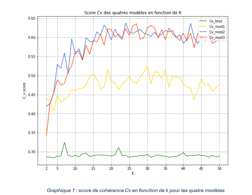

  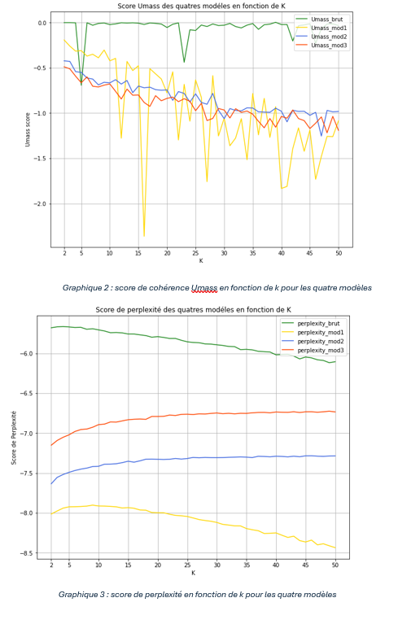

Ces trois graphiques nous révèlent plusieurs informations utiles quant à la sélection de modèles. Pour commencer notre analyse, nous regardons notre modèle brut, qui est notre expérience témoin dans cette situation. Nos calculs nous révèlent que, de tous les modèles, il a la pire cohérence Cv et Umass ainsi que la pire perplexité. Cela est dû à sa complexité, car il possède une multitude de dimensions, ce qui rend difficile la conception de thèmes uniques et distincts. De plus, la présence de nombreuses matrices clairsemées impacte négativement la perplexité du modèle. En réalité, nous ne cherchons pas à optimiser le paramètre k dans ce cas. En effet, cette modélisation de sujets produirait probablement un ensemble de vecteurs de mots non interprétables, car composée de mots grammaticaux et d’artefacts de mise en page. De plus, nous remarquons principalement pour le score Umass et Cv beaucoup de variabilité à l’observation des courbes. On voit cela notamment en observant les variations du modèle brut en comparaison avec celles du modèle 1. Dans ce cas, on peut expliquer ces changements par le retrait des grammaticaux qui étant très fréquents donne de la stabilité à ces scores. En retirant du bruit, on ajoute de la variabilité progressivement. Cependant, notamment en nettoyant par fréquences et en lemmatisant notre corpus, on peut risquer de supprimer la variabilité en cas de trop fort retrait de variable. C’est donc cet ensemble de facteurs qui explique la forte variabilité de nos métrique pour les modèles nettoyés. 
Nous regardons ensuite le modèle qui a subi la normalisation des données. On voit une nette amélioration de toutes les métriques. Ce qui nous intéresse plus particulièrement est le score Umass qui, s’il est nettement meilleur, comporte beaucoup d’optimums locaux. Par exemple, pour k = 13 et k = 15, on observe des minimums locaux très prononcés. Cela nous indique que la cohérence des sujets composés avec ces données est très sensible à la variation de k, rendant difficile l’optimisation du modèle en se basant sur le score Umass. En revanche, quand on regarde le score Cv, la courbe semble atteindre un plateau à partir de 15 sujets. Quant à la perplexité, la courbe se stabilise entre 15 et 18 sujets. Ce qui peut paraitre surprenant est que des modèles avec plus de nettoyage ont un score plus élevé indiquant une moins bonne perplexité. On peut expliquer cela par l’impact des étapes de lemmatisation et de nettoyage par POS qui enlève du contexte à notre vocabulaire rendant le LDA moins résilient aux corpus. 
Cela nous amène à analyser les modèles 2 et 3 qui ont été plus amplement nettoyés. Bien que le score CV soit relativement similaire pour les deux modèles, le score Umass semble indiquer une légère amélioration de la cohérence pour le modèle qui n’a pas subi de nettoyage POS. Quand on regarde la perplexité pour ces deux situations, le modèle 3 ressort plus fiable que le deuxième. Pour le modèle 1, les courbes semblent atteindre un plateau pour k ∈ [15,25]. En ce qui concerne les modèles 2 et 3, les pentes des courbes semblent généralement s’atténuer dans l’intervalle k ∈ [18,25]. Afin de sélectionner la segmentation de sujet la plus cohérente, nous avons décidé d’analyser les résultats de LDA pour des valeurs de k dans un intervalle un peu plus large, soit pour le modèle 1, k ∈ {12,…,27} et pour le modèle 2 et 3, k ∈ {15,…,27}.En élargissant le champ de notre recherche par essais et erreurs, nous souhaitons nous assurer de ne pas manquer une modélisation finale plus claire et plus facile à interpréter, malgré les différentes métriques de sélection que nous avons utilisées. Nous devons aussi souligner que le score Cv et Umass ont une nature heuristique qui les rend moins stables et plus variables par nature, ce que l’on peut observer dans les graphiques ci-dessus.

#### IV.2.b.v) Analyse des sujets des modèles
Cette méthode nous a amenés à choisir un modèle avec 15 sujets pour le premier et 19 pour les modèles 2 et 3. Nous pouvons voir les résultats de ces différents LDA en annexe 15 et 16 ainsi que dans le tableau suivant.

  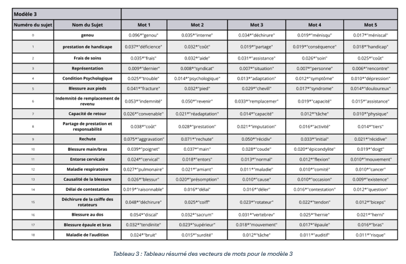

Notre analyse révèle que le modèle 3 à 19 sujets est le plus lisible et interprétable. En effet, chaque vecteur de mot est tout de même très lisible et relatif à une forme de pathologie ou un sujet relié au cadre du droit. Le modèle 1 est rempli de mots difficiles à interpréter comme « elle » ou « date », par exemple. Malgré cela, on peut tout de même constater de cohérences pour certains vecteurs formés, comme pour le sujet 2, qui est relatif aux blessures au dos. Cela étant dit, la majorité des regroupements sont ininterprétables et contiennent trop de bruit statistique pour les rendre cohérents par notre lecture. Le modèle 2, lui, ressemble beaucoup à notre modèle final. Cependant, comme nous l’avons évoqué précédemment, nonobstant le retrait des stopwords, nous avons des sujets comme le 18 (annexe 16) qui sont difficiles à interpréter. En effet, comme nous l’avons souligné plutôt, le regroupement de notions relatives à des maladies pulmonaires et à des pathologies affectant l’audition rend la lecture de ce dernier compliqué. On peut aussi souligner le sujet 7 dans la même annexe qui semble être relatif au mouvement, mais qui ne nous indique pas vraiment un thème clair et identifiable à lui attribuer. Les nettoyages ont cependant porté leurs fruits, car on voit se distinguer des sujets portant sur les enjeux psychologiques, par exemple, ou encore des sujets spécifiques relatifs aux déchirures de la coiffe des rotateurs. Finalement, lorsque l’on regarde le dernier modèle présenté dans le Tableau 3, on remarque que la diminution de dimensionnalité a bien fonctionné nous donnant des sujets distincts. Néanmoins, certains de ces vecteurs nous ont demandé de plus amples recherches pour comprendre leurs contenus. Dans cette catégorie, on retrouve le sujet 2 relatif à la représentation. Les mots qui le composent sont compliqués à relier les uns aux autres pour un novice dans le domaine du droit du travail. Ainsi, pour mieux comprendre ce regroupement, nous avons décidé de lire les 10 jugements qui avaient le plus de proximité avec ce sujet. À la lecture de ces derniers, nous avons remarqué que ces jugements traitaient d’enjeux de représentation par le syndicat. Indéniablement, ces textes abordent souvent la dernière rencontre avec le syndicat, le statut de salarié de l’employeur, ainsi que le contenu des réunions avec le syndicat. De plus, dans tous ces jugements, le syndicat a joué le rôle de représentant. Parfois, la représentation du syndicat est contestée, ce qui amène le tribunal à examiner la dynamique des relations entre l’employé et son représentant. C’est pourquoi le mot « temps » est utilisé. Pour d’autres sujets, nous avons effectué quelques recherches pour savoir si les mots pouvaient correspondre à des symptômes précis, comme pour le sujet 15 qui aborde la déchirure de la coiffe des rotateurs. Finalement, les sujets 6 et 7 sont très proche sémantiquement l’un de l’autre, mais la composante financière du sujet 6 ressort avec le mot indemnité ou encore montant ou prestation. En complément à cela, nous avons poursuivi nos recherches en analysant les composantes essentielles relatives aux indemnités de remplacement et nous avons trouvé sur le site internet de la CNESST (CNESST, 2024) que l’examen pour évaluer la date de début ou de fin de cette indemnité comportait de nombreux points sémantiques communs avec ce vecteur de mot. Cette étape de notre projet souligne l’importance de la compréhension et de la maitrise des éléments du droit pour sélectionner les modèles cohérents. Dans ce travail, nous avons complété nos analyses quantitatives avec des recherches superficielles pour nous assurer de la cohérence de notre modèle, mais l’avis d’un expert juridique serait un atout pour permettre de mieux comprendre nos sujets et d’approfondir nos analyses. Afin de finaliser notre analyse, nous avons calculé les scores de performances de ce modèle. Nous obtenons un score de cohérence Umass de -2,68, Cv de 0,61 et un score de perplexité de -8.67. Ces scores peuvent être modifiés, car le modèle de LDA reste stochastique, ce qui introduit de l’aléa avec l’utilisation de l’algorithme. De ce fait, la perplexité de cette modélisation de sujet est améliorée là où la cohérence Umass est légèrement dépréciée. Le score Cv est relativement stable avec nos itérations précédentes. Nous soulignons ici que nous avons fait plusieurs modélisations avec les mêmes paramètres qui nous donnaient des résultats très proches, mais nous avons tout de même choisi le résultat le plus cohérent à notre lecture. Finalement, nous n’avons pas ajusté les autres hyperparamètres que sont α et ß. Le LDA postule une distribution des sujets a priori et le paramètre α sert à déterminer cette dernière. Plus on suppose qu’un texte aborde plusieurs sujets, plus on cherche à augmenter ce dernier paramètre. Dans notre cas, nous avons gardé la valeur par défaut de ce paramètre, soit α = 1. Ce choix est motivé par les prémices qui consistent à voir les jugements comme des textes avec un sujet central qui est la question de droit adressé au tribunal, puis des sujets périphériques se greffent autour de cela pour alimenter la réflexion et la preuve. Le paramètre ß régit la distribution à priori des mots dans les thèmes composés. Plus le dernier est élevé, plus on postule que les sujets contiennent une grande variété de mots. À l’inverse, moins il est élevé et plus nos sujets sont concentrés autour de quelques mots. Nous avons aussi choisi de garder un ß par défaut qui donne la même probabilité à chaque mot d’appartenir à un sujet. Nous avons fait ce choix, car nous n’avions pas d’idée prédéterminée de la distribution des mots dans les sujets. L’ajustement de ces paramètres est un élément à considérer pour d’autres travaux, mais les résultats obtenus sont satisfaisants pour la suite de ce travail.