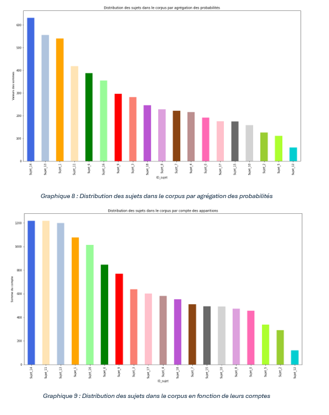
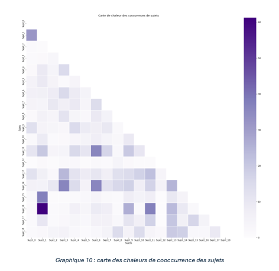

## V.1) Modélisation de sujets
Dans nos analyses, nous avons discuté de la sélection du modèle de LDA et particulièrement du nombre de sujets sélectionné pour composer notre analyse sémantique. De cette étude, nous en avons déduit 19 sujets résumés dans le tableau 3. L’objet de l’étude des résultats réside dans la compréhension de la distribution de ces derniers dans le corpus. Le LDA nous donne une distribution sujet/documents qui est interprétable en probabilité d’appartenance d’un document à un sujet. Comme spécifié dans nos analyses, nous avons examiné les 10 textes les plus représentatifs de chaque sujet afin de confirmer que notre modélisation était cohérente. De cette analyse manuelle, nous avons constaté que les sujets ont une cohérence avec les textes qui les représente le plus. À la suite de cela, nous regardons comment les sujets se répartissent dans le corpus. Pour cela, nous avons regardé la somme des probabilités dans le corpus dans le graphique 8. Puis nous avons regardé le compte d’apparition des sujets dans le corpus dans le graphique 9.
### V.1.a) Probabilité et distribution des sujets dans le corpus

  

Pour lire ces graphiques, il est important de consulter le tableau 3 des résultats qui décrit les sujets dans nos analyses. Le sujet le plus fréquent tant en probabilités qu’en quantités est celui relatif aux délais de contestations. Ce résultat est cohérent, car la discussion des délais de réclamation est un enjeu fréquemment abordé pour attester de la validité de la demande. À l’opposé, on retrouve le sujet sur les maladies respiratoires dans les sujets les moins représentés dans le corpus. Cela demeure cohérent, car cette thématique aborde une pathologie spécifique et qui ne concerne pas une majorité d’industries et de métiers. En effet, on peut raisonnablement inférer que cette pathologie affecte des métiers en lien avec l’amiante ou des environnements composant une exposition forte à des agents aériens pathogènes. Plus généralement, quand on regarde les cinq sujets les plus fréquents et probables dans le corpus, on peut remarquer quelques éléments. On remarque que certains de ces sujets, comme le 11 et le 13, respectivement relatifs aux entorses cervicales et au lien de causalité de la blessure n’ont pas la même position entre le compte et la probabilité. On peut souligner que les cas relatifs aux entorses cervicales sont plus présents dans le corpus, mais les textes qui traitent de ce sujet ont une probabilité d’appartenir à ce sujet globalement plus fort. Cela peut s’expliquer par le fait que les mots qui composent le vecteur du sujet sur la blessure cervicale comportent des mots que l’on peut retrouver dans plusieurs autres vecteurs, comme « entors », par exemple. Cela influence le compte, car ce sujet peut être présent de manière diffuse dans le corpus. Plus généralement, on retrouve ces six sujets dans des ordres différents cependant haut dans les deux graphes. Cela s’explique par la nature de ces sujets, que l’on explicite ci-dessous:
	
* Sujet 1 : prestation de handicap
* Sujet 6 : indemnités de remplacement
* Sujet 11 : entorse cervicale
* Sujet 13 : lien de causalité
* Sujet 14 : délais de contestation
* Sujet 16 : blessures au dos

L’ensemble de ces sujets constitue des pathologies plus communes ou des éléments fréquemment débattus devant le tribunal. Pour ces raisons, il est logique que notre corpus parle plus des blessures aux dos qui peuvent affecter une grande variété de métiers que des maladies respiratoires plus relatives à certains types d’activités. De même, les délais de contestations, les prestations de handicap ou les indemnités de remplacement sont souvent les éléments qui sont en jeux pour les demandeurs. En effet, le but de nombreuses actions face au TAT vise au dédommagement d’un préjudice subi. Il est donc naturel que cet élément constitue une grande portion des sujets abordés par notre corpus. Pour donner suite à cela, nous regardons les trois sujets les moins fréquents :

* Sujet 2 : frais de soins
* Sujet 5 : blessures au pieds
* Sujet 12 : maladies respiratoires 

Les sujets 5 et 12 traitent de pathologies très spécifiques qui, comme on l’a vu plutôt, ne se retrouvent pas dans les décisions concernant cette niche particulière des accidents du travail. La portion sur les frais de soins est plus surprenante. En effet, nous nous serions attendus à ce que ce sujet soit plus fortement représenté dans le corpus, car constituant un élément crucial dans les démarches au tribunal. En regardant les 10 textes les plus représentatifs du sujet, nous avons une piste de réflexion sur la faible représentation de ce sujet. Dans ces jugements, nous retrouvons systématiquement des travailleurs qui viennent demander un remboursement après une intervention médicale ou une installation de prothèses auditive, par exemple. L’aspect rétroactif de ces demandes en fait des cas plus rares, car il est plus difficile de montrer a posteriori le lien entre la maladie et le travail après intervention médicale. De plus, ces cas traitent souvent de travailleurs agissant plusieurs années après la fin de l’emploi, rendant la démarche encore plus complexe. En revanche, il est plus simple de faire reconnaitre la pathologie par le tribunal en vue de faire prendre en charge via les prestations de handicap ou de remplacement les soins et les préjudices. Bien que nos connaissances juridiques soient limitées sur ce sujet, nous vous proposons cette explication. Il serait cependant judicieux de creuser davantage ce thème avec un spécialiste du domaine. Pour finir notre analyse sur la distribution des sujets dans le corpus, nous regardons de plus près les sujets restants. Si les sujets 9 et 3 relatifs à la rechute et à la représentation sont plutôt souvent représentés, car, encore une fois, ils touchent à des enjeux centraux du tribunal, nous sommes surpris par le changement de position entre les probabilités agrégées et le compte d’autres sujets. Le premier qui mobilise notre intérêt est le sujet 17 relatif aux blessures aux bras et épaules. En effet, on retrouve ce sujet dans de nombreux textes. Cependant, l’agrégation des probabilités montre que ce dernier n’est pas aussi central dans l’appartenance des textes qui le représentent. Dans ce cas, le sujet est très large, car de nombreux sujets touchent à des éléments relatifs aux bras et épaules. En revanche, peu de textes se concentrent fondamentalement sur une déchirure des coiffes des rotateurs, par exemple, qui est une pathologie précisément reliée aux épaules. Ainsi, comme dans le cas du sujet 6 relatif aux entorses cervicales, ce dernier est diffus dans le corpus, ce qui explique le compte élevé, mais des probabilités plus faibles. Un autre sujet surprenant est le 18 relatif aux maladies auditives. Ce dernier est fort dans le classement probabiliste, mais plus faible dans le compte. Ce cas peut s’expliquer par la présence d’un corpus de mot très précis qui rend uniques les jugements qui y sont rattachés et par le fait les rend fortement reliés au sujet. Ainsi, le faible nombre de textes dans lequel il est présent ont des probabilités fortes d’y appartenir, rendant le sujet fortement représenté en probabilités, mais moins en ce qui concerne le nombre de sujets susceptibles d’y appartenir. On peut aussi souligner le sujet 4 relatif à la condition psychologique, qui est tout de même le 10e sujet le plus présent dans le corpus et le 12e le plus probables. Cela nous indique que les enjeux psychologiques ont tout de même une importance dans les débats du TAT en 2017. Nous aurions pensé voir ce dernier plus bas, nous attendant à ce que les pathologies physiques soient plus représentées dans le corpus. Dans le même ordre d’idées, nous aurions pensé que le sujet 8 relatif au partage des prestations aurait été plus haut, car constituant un élément important des enjeux du tribunal. Il se classe dixième en somme de probabilité, mais quinzième en importance, ce qui signifie que le sujet est crucial pour les textes qui s’y intéressent, mais qu’il est relativement négligé par la plupart des écrits. Nous nous serions plutôt attendus à voir l’inverse dans ce cas, pensant que le partage des prestations était un élément récurant des arbitrages du tribunal. Il semble qu’en réalité, en déterminant les responsabilités et les liens de causalité, les éléments de partages soient déterminés assez naturellement par le tribunal. Les éléments relatifs aux partages sont alors plus rares et précis, ce qui explique son importance moins décisive que nous l'avions imaginé. Les autres sujets sont répartis de manière relativement cohérente dans le corpus à nos yeux et ne montrent pas d’écarts majeurs entre les deux graphes. Les différences observées peuvent s’expliquer par la nature des sujets. En effet, ils peuvent  être très larges, ce qui les rend présents dans de nombreux textes. Cela explique un rang plus élevé dans le compte que pour la somme des probabilités. Pour continuer d’exposer nos résultats, nous proposons de regarder la cooccurrence des sujets afin de déceler de potentielles convergences entre certains d’entre eux. 

### V.1.b) Cooccurrence des sujets 
Afin de modéliser les cooccurrences de sujets dans le corpus, nous avons produit une matrice sujets-sujets se basant sur les probabilités d’apparition des sujets dans chaque texte du corpus. Cette matrice est composée de 361 cases au total, soit 19 colonnes par 19 lignes qui représentent nos sujets. Afin de rendre ces résultats plus lisibles, nous proposons une carte des chaleurs dans le graphique 10. Cette matrice étant symétrique, nous avons décidé de modéliser que le bas de la diagonale de celle-ci. 

  

Dans cette carte de chaleurs, plus les sujets cooccurrents et plus les tuiles qui les représentent sont foncés. Nous constatons que les sujets 16 et 1 apparaissent très fréquemment ensemble. Il s’agit des thèmes relatifs aux prestations de handicap et aux lésions au dos. Dans le but de comprendre ce fait, nous avons regardé plusieurs documents de la CNESST. Dans son guide des orientations en imputations de 2023 (CNESST, 2022), nous avons trouvé que les blessures au dos étaient une des lésions les plus fréquemment évoquées dans le cadre de l’imputation de prestation de handicap. Le même document mentionne également les entorses cervicales dans les lésions communément sujettes à des prestations d’invalidité, ce qui explique la cooccurrence relativement élevée du sujet 11 et 1. Il en est de même pour la déchirure de la coiffe des rotateurs, qui est illustrée par le sujet 15 et des lésions aux genoux incarnés par le sujet 0, qui sont aussi détaillés dans ce document. Regardons de plus près la ligne du sujet 16, qui présente plusieurs autres points de cooccurrence élevés. Outre le sujet 1, on note le sujet 9 relatif aux rechutes, le sujet 11 relatif aux entorses cervicales et le 13 relatif à la causalité de la blessure. Il est logique de penser que les entorses cervicales peuvent entraîner des lésions dorsales à long terme. Le dos étant impliqué dans divers mouvements, en particulier ceux de portage, les rechutes sont alors probables. Finalement, afin d’obtenir une compensation, le travailleur doit prouver le lien entre la tâche en emploi et la blessure subie. Dans le cas du dos, de nombreuses activités extra-professionnelles peuvent intervenir dans une blessure, on peut donc déduire que l’examen du juge repose sur la capacité de déterminer la causalité entre un événement au travail et la blessure subie par le demandeur. Plus généralement, on remarque que le sujet 13 est cooccurrent avec de nombreux autres thèmes. De même sorte que le sujet 14 relatif aux délais de contestations, il s’agit d’enjeux de procédure qui sont très fréquemment abordés dans le sujet, comme le montrent les graphique 8 et 9. On peut constater que ces derniers sont aussi très cooccurrents l’un avec l’autre, nous indiquant l’importance de ces procédures dans la logique du tribunal. Une autre cooccurrence élevée concerne le sujet 6 et 11. Cela nous indique que les entorses cervicales et les enjeux d’indemnités de remplacement sont fréquemment évoqués simultanément dans plusieurs jugements de notre corpus. Nous n’avons pas trouvé d’explications satisfaisantes pour justifier ce point dans notre corpus. Cela peut être lié à un biais de nos données, en effet, peut-être qu’un 2017 de nombreuses réclamations de remplacement de revenus ont été faites dans le cas d’entorse cervicale. Il est aussi possible qu’un lien juridique plus complexe soit à l’œuvre qui amène une cooccurrence de ces sujets qu’un spécialiste pourrait possiblement expliquer. Finalement, nous voulons regarder deux sujets de plus près qui portent des surprises. Le sujet 4 relatif à la condition psychologique apparait relativement fréquemment avec la thématique des entorses cervicales. S’il peut y avoir un aspect psychologique à une blessure, nous sommes surpris que le cas des entorses cervicales soit plus important que les autres. Une explication possible est que les entorses cervicales surviennent régulièrement à l’occasion d’accidents de la route qui peuvent traumatiser la victime de ce dernier. On peut aussi supposer que ces blessures entrainent de potentiels pertes de sommeils impactant la santé mentale. L’autre sujet qui comprend des surprises est celui relatif aux maladies auditives. S’il a une forte cooccurrence avec les thèmes relatifs aux délais, aux liens de causalité et à la rechute, nous avons aussi une cooccurrence avec les blessures aux mains et aux épaules. Plusieurs pistes s’ouvrent à nous pour expliquer cela. La première est technique et concerne le nettoyage de nos données. En effet, nous avons souligné que le mot « exposition » compliquait la distinction entre les sujets, tels que ceux liés à la surdité et aux maladies respiratoires. Peut-être alors que des éléments de vocabulaires approchent les sujets relatifs aux blessures aux bras et à la main avec le sujet de la surdité. Une autre explication repose dans la compréhension de la surdité et de la détection de cette dernière. Concernant la surdité, de nombreuses personnes affectées par cette pathologie communiquent via le langage signé donc avec les mains. Cet élément peut avoir un impact dans la cooccurrence des deux sujets, car le mot « main » peut alors apparaitre dans le vocabulaire relatif au langage signé. Relativement à la détection de la surdité, en regardant le manuel de Merck (Hamiter, 2024), nous avons pu comprendre que, pour obtenir un diagnostic de surdité, les professionnels font passer un test aux deux oreilles avec différentes fréquences d’ondes en demandant de lever la main ou le bras au patient. Les sources médicales étant souvent convoqué et cité dans nos textes, ces éléments peuvent avoir un impact dans la cooccurrence des deux sujets. Cette hypothèse est celle que nous favorisons, car nous avons constaté qu’il était fréquent de la part du tribunal d’utiliser des évaluations médicales pour appuyer la preuve.

### V.1.c) Comparaison avec la classification de la CNESST
Pour conclure sur les résultats de nos analyses sémantiques, nous avons constaté que la modélisation de sujet était efficace pour modéliser les textes de notre corpus. Il est intéressant de voir que les classifications proposées par la CNESST sont présentes dans cette modélisation. De plus, on peut voir que deux grandes familles de sujets sont formées. La première est relative aux éléments de procédures comme le sujet relatif aux délais, aux prestations de handicap ou de remplacement de revenus, et d’autres sont relatifs aux pathologies, comme les maladies auditives, les lésions au dos ou les entorses cervicales. L’étude de l’élément sémantique nous démontre que, par ce biais nous pouvons efficacement et facilement comprendre les sujets abordés par un corpus juridique. Si ce mémoire se concentre sur la tâche d’appareillements de cas, cette modélisation porte de nombreux éléments d’intelligence qui peuvent possiblement améliorer notre compréhension du fonctionnement du TAT. 
