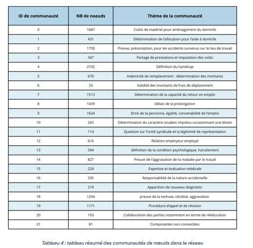
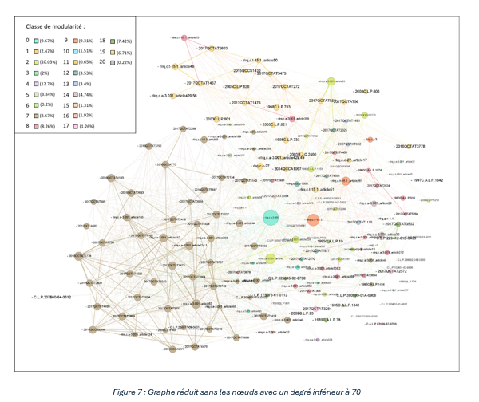
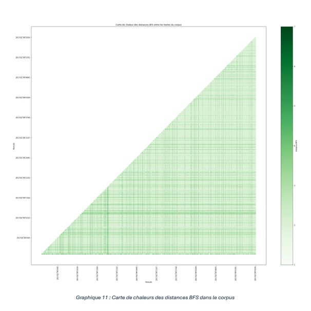
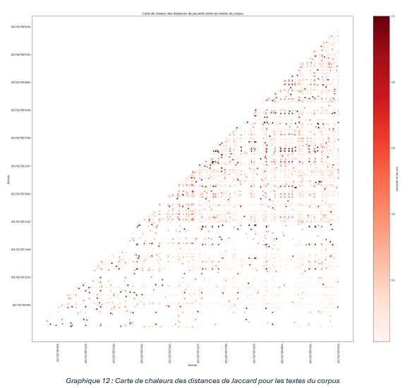
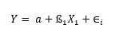
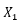
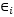
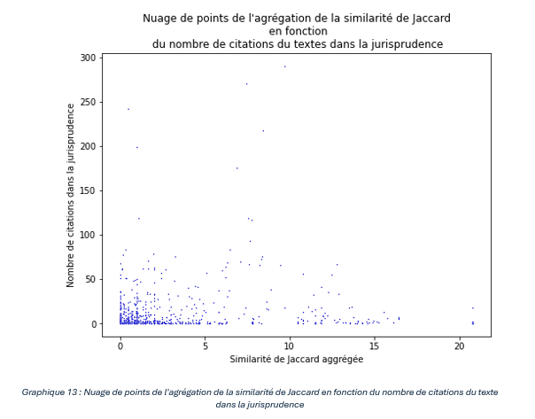
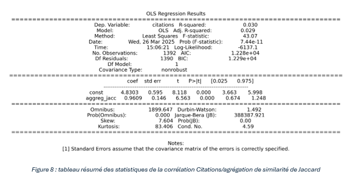

## V.2) Modélisation de réseau de graphe
Dans nos analyses nous avons démontré que le réseau de graphe complet possédait une structure de communauté intéressante avec une modularité de 0,648. En outre, nous avons constaté que des nœuds semblent polariser une grande quantité de connexion dans le graphe. Nous avons également discuté de la décomposition du graphe en examinant les sous-graphes des lois et des jurisprudences, ce qui nous a permis de comprendre visuellement la constitution de notre réseau. Le calcul de modularité nous a permis de déterminer des communautés qui peuvent être étudiées pour comprendre leurs structures. Nous proposons de partager les résultats de ces analyses dans un premier temps, ce qui nous permet aussi de mettre de l’avant les nœuds les plus importants du graphe. Puis, nous avons calculé deux mesures de distances, celle de Jaccard et la BFS. Dans un deuxième temps, nous regardons les résultats de ces calculs au sein du corpus afin de déterminer si nous pouvons déceler des proximités dans notre corpus pouvant nous servir à appareiller des jugements les uns avec les autres. 
### V.2.a) Interprétation des communautés
Nous commençons donc par étudier les regroupements de communautés du réseau que nous avons identifiés. Comme évoqué dans nos analyses, on retrouve 21 communautés dans notre graphe une fois les éléments indépendants isolés. Par ce biais, on peut alors identifier 22 communautés, car nous considérons que les 22 textes non connectés sont alors à regrouper sur cette caractéristique. Pour analyser ces regroupements, nous avons utilisé une approche similaire à celle des sujets formés par le LDA. Nous avons examiné dans chaque communauté les lois, les références jurisprudentielles et les textes de nos corpus avec les plus hauts degrés. Dans un souci de constance, nous avons consulté entre 15 et 20 documents par communautés afin de déterminer les enjeux que ces dernières portent. Nous résumons nos résultats dans le tableau 4 ci-dessous. 

  

En regardant ce tableau résumé, on peut voir que notre intuition de mesurer les éléments de procédure juridique à l’aide des citations se confirme. En effet, on retrouve dans les intitulés des groupes uniquement des éléments afférents à de la procédure, mais pas d’éléments afférents à des termes médicaux, contrairement aux sujets composés par le LDA. Pour notre analyse, nous regardons la communauté 21, qui est composée de textes sans connexion ou avec de faibles connexions c’est-à-dire deux nœuds. Nous avons expliqué plus haut que ces textes constituent des cas à part qui s’inscrivent dans la volonté de clarification du TAT ou qui ne traitent que d’éléments d’experts. Ensuite, nous regardons la communauté 0, qui est relative à plusieurs interprétations de procédures reliées à la LATMP. C’est la troisième plus grande communauté avec 1 687 nœuds. C’est aussi la plus complexe à analyser et à détailler. Cependant, la plus grosse partie de notre réseau est constituée de la LATMP, et on y trouve exclusivement des articles qui y sont liés. En regardant la liste des références, on retrouve la jurisprudence société de transport de la communauté urbaine de Montréal C. Racine qui parle de la manière de déterminer la responsabilité dans une maladie professionnelle si plusieurs employeurs sont impliqués. On peut aussi souligner, Perfect-Bois inc. qui évoque la présomption de la maladie et la place de la preuve médicale dans la détermination des faits. Les articles les plus évoqués de la LATMP sont le 204, 145, 328 et 142. Ces articles parlent tant des exigences que le TAT peut soumettre en termes d’évaluation à un travailleur que des mesures d’imputation des coûts.  En regardant les textes de notre corpus, on réalise que le lien qui unit ces textes est le débat du fardeau des coûts du matériel installé à domicile pour assister une victime de maladie professionnelle. À ces fins, déterminer la lésion et les capacités d’action du tribunal dans le cadre de la réadaptation et de la réhabilitation devient logique. Des 20 textes du corpus que nous avons consultés, 18 portaient sur les frais relatifs à l’installation de lits mécaniques ou d’appareils auditifs et autres matériels d’assistance. Finalement, on retrouve la jurisprudence Mathieu et Désourdy-Durenceau ent. Inc. qui adresse la conception de réadaptation sociale en lien avec le remboursement de l’achat d’un appareil optique, qui est une des références les plus citées de la communauté avec un degré de 9. Ensuite, nous regardons le regroupement 1 qui est relatif aux éléments de détermination de l’allocation d’aide à domicile contenant 431 nœuds. Ici, on retrouve l’article 165 de la LATMP qui établit le montant de la prestation d’aide à domicile auquel est éligible un travailleur atteint par une lésion.  On retrouve aussi le règlement sur les normes et les barèmes de l’aide personnelle à domicile, qui édicte le cadre spécifique de l’application de l’article 165 de la LATMP.  À cela s’ajoute le cas P.E. Boisvert auto ltée. qui propose une interprétation de l’article 165 de la LATMP. L’étude des textes du corpus qui compose cette communauté nous révèle que ceux-ci mettent l’emphase sur le montant, la légitimité et la nécessité d’aide à domicile d’une victime de lésion professionnelle. La communauté 2 est la deuxième plus grande et comporte 1 750 nœuds. Elle a trait aux éléments de preuve, présomption pour les accidents survenus en milieux de travail. Ici, on retrouve l’article 28 de la LATMP, qui est l’article qui postule qu’une blessure arrivant sur le lieu de travail est frappée d’une présomption de lésion professionnelle. Cela implique que le fardeau de la preuve repose sur l’employeur, c’est à lui de prouver que ce n’est pas une lésion professionnelle. La jurisprudence la plus citée est Chaput c. Société de transport de la Communauté urbaine de Montréal qui parle de la norme de santé sur laquelle la cour doit se baser pour juger la condition physique de la personne en cause. Outre cela, l’article 224 de la LATMP, avec un niveau de 517, traite de la valeur du diagnostic pour la prise de décision du tribunal. En effet, les textes du corpus qui composent ce sujet débattent de preuves et des éléments d’évaluation de la validité de la lésion. La 3e communauté regroupe des nœuds qui sont relatifs au partage des prestations et à l’imputation des coûts. On retrouve ici l’article 31 de la LATMP relatif à la définition de la lésion professionnelle ainsi que les articles 327 et 73 qui abordent l’imputation des coûts aux employeurs et la détermination du revenu brut d’un travailleur en vue de fixer le montant de l’indemnité de remplacement de ce dernier. On retrouve plusieurs textes du corpus et jurisprudences qui abordent la contestation de l’imputation des coûts reliés à ces enjeux. La quatrième communauté est la plus grande et est composée de 2 102 nœuds. Cela s’explique par la thématique que balaient les documents qui la composent. Ici, on retrouve des jugements comme Municipalité Petite-Rivière-St-François et C.S.S.T. qui définissent ce qu’est un travailleur déjà handicapé avant lésion et le rôle que joue cet élément. On retrouve aussi l’article 329 de la LATMP qui intègre cette notion de handicap dans la loi. Les textes du corpus que nous avons regardés comportent cette notion de handicap de manière centrale. La 5e communauté relative à la détermination des montants pour l’indemnité de remplacement se caractérise par le nœud représentant l’article 67 de la LATMP relatif au détail de la détermination du revenu brut du travailleur à considérer pour cette indemnité. Ce qui la différencie de la communauté 3 est les références à la loi sur les impôts, notamment les articles 1019.4 et 42.11 relatifs aux pourboires. Par ce fait, on peut déduire que ce regroupement est fortement relié à la détermination du revenu en vue de fixer le montant spécifiquement de cette indemnité. La sixième communauté elle est la plus petite. Elle regroupe les documents parlant de la validité des indemnisations des montants pour les déplacements. Ici on parle de taxis ou de véhicules utilisés pour pallier le manque de mobilité qu’entraine une lésion. On retrouve que trois textes du corpus, mais de nombreuses références pour appuyer ces cas. Le 7e groupe est plus imposant, car composé de 1 513 nœuds. Il regroupe les textes qui parlent de la capacité de retour en emploi. Dans ce cas, la difficulté repose sur la grande diversité de lois et de références qui sont convoqués. Mais on peut retrouver les articles 44, 46 et 48 de la LATMP qui portent tous une notion de retour en emploi. Cela, cumulé avec les jurisprudences et la lecture du corpus, nous a fait comprendre que ces éléments font toujours référence à la capacité de l’employeur à retourner en emploi à des fins de maintien ou de suppression des montants qu’il touche. Le 8e regroupement est relatif aux délais de prolongation et de contestation, ici on relève l’article 15 de la LITAT qui donne le cadre des prolongations de délais de contestations pour le TAT.  On peut aussi souligner les articles 358, 359 et suivant de la LATMP qui sont concentrés sur les délais de contestation. Finalement, la jurisprudence Hôpital Maisonneuve-Rosemont est la plus sollicitée dans cette communauté et établit de manière pratique ce qu’est un motif raisonnable de prolongation. La neuvième communauté est la troisième plus grosse avec 1 624 nœuds. Elle parle des droits de la personne de l’égalité en milieu de travail pour une personne affectée par une lésion et du caractère convenable de l’emploi. Dans ce dernier, on peut lire l’article 47.2 du Code du travail, qui évoque la bonne foi, la négligence et l’arbitraire dans le milieu de travail. On peut y adjoindre l’article 32 de la LATMP qui encadre le comportement de l’employeur vis-à-vis de la personne blessée, notamment en ce qui concerne le congédiement ou le changement de poste du travailleur. On retrouve aussi l’article 2858 du Code civil qui parle des droits et de devoir dans le respect des droits de la personne en vue de l’obtention de preuves. De plus, on peut souligner les références à des jugements de la Cour suprême, comme le [1984] 1 RCS 509 qui touche à la digne représentation du travailleur par son syndicat. Plus généralement, de nombreuses références sont issues de la Cour suprême ou de la cour supérieure, qui ont généralement l’expertise sur les enjeux de droit à la personne. La communauté 10 comporte 263 nœuds et est relative à la détermination du caractère soudain d’un événement occasionnant une lésion. La référence la plus citée est Plomberie et chauffage Plombec inc. et Deslongchamps qui clarifie la notion d’accident à l’occasion du travail. Aucune loi ne se retrouve dans ce regroupement, mais de nombreux textes du corpus, dont les 15 plus connectés, portent tous cette composante en leurs seins. La 11e communauté est relative à la légitimité de la représentation syndicale. Ici on retrouve seulement 114 nœuds et 9 textes du corpus. Cette communauté se différencie de la 9e par le fait qu’on ne parle pas de la notion de représentation juste ici, mais plutôt de savoir si l’employé peut être représenté par le syndicat, s’il appartient à la bonne unité de travail. La communauté 12 est relative au lien employeur employé. On retrouve dans la référence de nombreux articles du Code civil du Québec qui traite du contrat.  De plus, on retrouve des jugements comme Les Rôtisseries St-Hubert qui parle de la conciliation travailleur employeur. Les textes du corpus reliés ici sont majoritairement relatifs à la relation de conciliation et quelques-uns traitent du statut de travailleur autonome. Le 13e regroupement est relatif à la définition du cadre pour les maladies professionnelles de type psychologique. On retrouve le jugement Welch et Groupe pharmaceutique Bristol Myers qui met en place le cadre d’interprétation d’événements constituant un caractère traumatique psychique. Globalement, on retrouve beaucoup de jurisprudence liée à la preuve du harcèlement moral dans le but de se qualifier comme victime de maladie professionnelle. On ne retrouve pas de lois spécifiques dans cette communauté, mais les textes du corpus qui y sont reliés portent toute la notion de maladie psychologique ou de traumatisme psychique. La 14e communauté est reliée à l’aggravation d’une maladie liée à l’activité professionnelle. L’interprétation de ce regroupement a été plus complexe, car les références majoritaires sont reliées à l’audition. Cependant, les textes du corpus de cette communauté ne parlent pas tous de problèmes à l’oreille. Cependant, ces citations sont convoquées pour établir si l’aggravation d’une condition peut être reliée à un travail spécifique. Ensuite, le 15e regroupement affaires aux cadres juridiques de l’évaluation médicale. On retrouve des lois comme la loi sur les laboratoires médicaux, article 1, qui définit des termes médicaux aux yeux de la loi, mais on retrouve aussi de nombreuses jurisprudences traitant du cadre dans lequel l’évaluation est admissible par le tribunal. La communauté 16 est relative aux responsabilités de la nature accidentelle ayant entrainé une lésion. Ici, on retrouve des jugements qui portent sur la responsabilité. Par exemple, le jugement Maçonnerie Francis Tousignant inc. l’employeur met en cause la responsabilité du travailleur qui a omis de mettre un cran de sécurité sur un levier hydraulique. La communauté 17 traite des éléments relatifs à de nouveaux diagnostics. Ici, les documents traitent de l’arrivée d’un nouveau fait au moyen d’un diagnostic et par le fait même de la révision d’une décision antérieure. La communauté 18 est composée de 1 294 nœuds, ce qui la classe dans les plus grandes. Par le fait, elle traite de la rechute, récidive et aggravation. Ici, les textes traitent du cadre juridique qui permet de déterminer une rechute, une récidive ou une aggravation, en s’appuyant sur l’analyse des événements possiblement connectés à cette situation. Juste derrière sur le plan de la taille, on retrouve la communauté 19, qui est relative aux procédures d’appels et de révision. L’article 15 de la LITAT est prépondérant avec un degré de 231. Cet article est relatif au temps du délai d’appels pour un demandeur. On relève aussi l’article 49 et 51 tous deux traitant des éléments de procédure d’appel. On retrouve aussi l’article 429.56 de la LATMP relatif à la révocation d’une décision. Le jugement Franchellini et Sousa avec un degré de 180, est centré sur l’interprétation d’un appel en vice de fond. On retrouve cet élément dans les 17 textes que nous avons analysés pour cette catégorie. Finalement, la dernière communauté, la 20e, est la deuxième plus petite avec 103 nœuds. On y retrouve 16 textes du corpus, que nous avons lus, qui traitent de la collaboration des parties en matière de rééducation. Ici, le sujet est la bonne foi et l’application de la part du travailleur ou de l’employeur du programme de réadaptation en vue de réintégrer l’emploi. 

### V.2.b) Graphe réduit
Afin de proposer une modélisation plus lisible, nous avons réduit le graph en n’affichant que les nœuds avec un degré supérieur à 70. Nous proposons dans la figure 7 la modélisation de ce dernier. La légende propose une couleur par classe de modularité du réseau ainsi que la part que représente cette classe dans les données en pourcentage. Cette figure nous confirme les éléments décrits plus haut et nous permet d’explorer les nœuds les plus importants dans le réseau de graphe ainsi que d’identifier les principales communautés visuellement.

  

L’analyse extensive des communautés que nous venons de proposer est essentielle, car elle nous révèle que l’analyse de ces dernières reposes sur la comparaison des différents documents qui les composent. De plus, on peut voir que, certaines fois les lois ne sont pas connectées directement aux communautés, mais plutôt des jurisprudences. Cela nous révèle que certains sujets juridiques s’appuient sur la subtilité de l’interprétation du cadre juridique et non sur la simple application des règles de droit. Finalement, on constate que le réseau nous indique des éléments juridiques que le LDA n’a pas soulignés. Nous indiquons donc que l’analyse de ces éléments a été faite à l’aide de nos connaissances du droit et de notre compréhension du corpus, qui nous permet tout de même de révéler une intelligence de nos données. À des fins de précisions, nous aimerions solliciter l’expertise d’un avocat ou d’un juge pour préciser l’analyse de nos résultats. Outre cela, nous avons concentré nos évaluations sur les nœuds les plus importants de chaque regroupement pour des raisons de moyens et de temps. Or, nous pourrions regarder un échantillon plus dispersé du regroupement afin de déterminer si des sous-catégories peuvent composer ces derniers.

### V.2.c) Similarité de Jaccard et distance
Afin de compléter notre partie sur la formalisation de la tâche juridique, nous avons proposé une étude de la similarité à l’aide de la distance et la similarité de Jaccard et la distance BFS. La taille du graphe étant imposante, nous regardons les textes du corpus entre eux pour regarder la proximité au sein du corpus. Dans ce but, nous proposons de regarder la carte des chaleurs pour la similarité de Jaccard et pour la distance BFS. Puis, dans chaque cas, nous regardons quelques éléments de statistiques agrégées relatives à ces deux métriques. 
Nous présentons les deux cartes de chaleurs dans les graphiques 11 et 12 ci-dessous. Il est important de noter que nos outils de visualisation se basent sur la similarité et non la distance de Jaccard, car cette dernière est plus facilement interprétable. En réalité, la distance de Jaccard se lit inversement à la similarité, plus elle est grande et moins les textes sont proches. Par le fait, les deux calculs sont des interprétations similaires de la même métrique. De plus, les deux cartes de chaleurs sont des outils pour avoir une vision globale du corpus. Cependant, la grande quantité de variables composant les matrices, soit 5 403 par 5 403, rend les matrices complexes à interpréter. 

  

  

Pour la carte des chaleurs de la distance entre les nœuds, la teinte foncée témoigne d’un écartement des nœuds les uns avec les autres. À l’inverse, les teintes claires révèlent une similarité éloignée, tandis que les teintes sombres révèlent une similarité plus grande. Finalement, les deux graphiques étant symétriques, nous proposons de montrer une seule partie de la diagonale. Plusieurs remarques émergent à la vue de ces deux graphiques. On souligne la nature clairsemée de la matrice pour la similarité de Jaccard. Cela implique que de nombreux textes ne sont pas similaires les uns aux autres. Cela s’explique par la grande dimensionnalité des références et le nombre de citations que comportent les textes du corpus. En effet, nous avions calculé une moyenne d’un peu plus de 12 citations par textes et nous avons compté 12 043 nœuds de références de lois et jurisprudences. Ainsi, la grande dimensionnalité explique le grand nombre de points nuls de la matrice. Malgré cela, on semble discerné des lignes plus foncées dans la carte que les autres. On peut donc voir que certains textes semblent avoir une forme de centralité dans leurs similarités. En regardant le graphique 11, on remarque que des lignes émergent dans les distances entre les textes. Ces lignes foncées reflètent des textes déconnectés du graphe et/ou faiblement connectés, comme notre analyse du graphe le révèle. Ici, on souligne une proximité globale des nœuds liés à la centralité de la LATMP dans le graphe. En effet, nous avons montré qu’une grande partie des textes s’appuient sur cette loi entrainant une forte centralité de cette dernière dans le corpus. Cela nous amène au constat que la distance ne nous permet pas forcément de déterminer plus d’éléments que celle que l’analyse des communautés nous apporte. Ce que cette carte révèle, c’est une modélisation des communautés du graphe, calculées par Gephi avec l’algorithme DFS, qui calcule également les distances entre les nœuds. Pour la suite de la présentation de nos résultats, nous regardons de plus près les statistiques relatives à la similarité de Jaccard qui portent plus d’information pour l’étude de notre corpus. 

### V.2.d) Similarité et nombre de citations
Pour approfondir nos analyses, nous regardons des éléments relatifs à l’importance de la similarité de Jaccard pour déterminer l’importance du jugement dans la jurisprudence. Pour cela, nous avons cherché sur CANLII, un site de référence juridique, le nombre de citations des textes de notre corpus dans l’ensemble de leurs bases de données jusqu’à aujourd’hui. Devant renseigner à la main ces informations, nous avons pris un échantillon de 1 392, soit un échantillon de 25% du corpus texte du corpus auquel nous avons ajouté cette dimension. Puis nous comparons cela à la somme de la similarité de chaque texte de la matrice que nous avons créée en retirant 1, car chaque texte a une similarité de 1 avec eux même. Ici, nous voulons voir si une forte similarité de Jaccard agrégée dans le corpus est liée au nombre de fois où ce texte est cité dans la jurisprudence actuelle. Pour vérifier, cela, nous propose une corrélation linéaire avec en variable cible le nombre de citations dans la jurisprudence et en variable explicative, soit :

  

Ici Y est l’agrégation des scores de Jaccard, a est l’ordonnée à l’origine,  est le coefficient de corrélation de la variable  qui est le compte du nombre de citations dans la jurisprudence et  représente les résidus. On commence par montrer le nuage de points de ces deux variables dans le graphique 13.

  

Ce nuage de points nous indique plusieurs choses concernant nos données. La première est le déséquilibre de l’échantillon qui comporte de nombreux points avec une similarité agrégée de 0, soit 698 points de l’échantillon, donc un peu plus de 50% de ce dernier. Cela est logique, car nous avons vu que le corpus comprenait de nombreux textes avec un score de Jaccard faible. Nous avons l’impression d’avoir identifié une corrélation entre l’augmentation du nombre de citations et l’augmentation du score de Jaccard. Cette tendance est difficile à détecter à l’œil. Nous regardons alors les éléments de corrélation de ces deux variables. Notre corrélation nous donne les résultats que nous présentons dans la figure 7 ci-dessous. 

  

Si on regarde la statistique F de 43,07 et la probabilité de la statistique F de 7,44 e-11, on peut en déduire que la variance que le modèle explique est plus grande que celle qu’il n’explique pas. On peut donc déduire que ce dernier est globalement significatif. En revanche, le r-carré est de 0,030, ce qui veut dire que seulement 3% de la variation du nombre de citations peut s’expliquer par l’effet de la similarité de Jaccard dans le corpus. Les coefficients de corrélation pour l’ordonnée à l’origine et l’agrégation de Jaccard sont tous deux significatifs, en témoigne leurs valeurs P et leurs erreurs standards faibles. Ce modèle nous indique que, pour une similarité de Jaccard agrégée de 0, on retrouve en moyenne 4,83 références dans le corpus complet du droit canadien. Puis on peut dire qu’une augmentation d’une unité de la similarité agrégée de Jaccard entraine une augmentation de 0,9609 le nombre de citations.  Cependant, le score de Durbin-Watson de 1,492 nous indique une possible autocorrélation positive potentielle des erreurs du modèle. Le faible r carré du modèle et le score de Durbin-Watson ne nous permettent pas de retenir ce modèle comme modélisation complète pour expliquer la variabilité du nombre de citations d’un texte dans le droit canadien. Or, on peut tout de même voir une tendance nous indiquant qu’une similarité de Jaccard agrégée forte d’un texte du corpus de 2017 avec les autres augmente sa probabilité d’être une référence dans le droit futur. Cette approche si imparfaite nous donne une base pour détecter de potentiels jugements importants d’une année en se basant sur sa similarité avec les autres de la même année. Nous pourrions considérer un modèle prédictif plus précis dans le futur afin d’identifier les jugements majeurs d’une année qui pourrait faciliter le travail qualitatif des analystes juridiques.
En conclusion, nous avons montré que des communautés dans le réseau existent et qu’elles correspondent à des éléments de procédure en lien avec les références de lois et de jugement sur lesquelles elles s’appuient. De plus, si la distance dans le graphe ne permet pas d’apporter plus d’information pour nos analyses, la similarité de Jaccard nous permet d’appareiller les textes du corpus les uns avec les autres. Nous avons aussi proposé de voir s’il existait un lien entre un texte avec une forte similarité dans le corpus et une potentielle importance dans le nombre de citations actuelles de ce dernier. Si ce modèle ne permet que de voir une tendance, car il n’explique que 3% de la variabilité du nombre de citations, cela nous donne une base de réflexion pour élaborer des modèles plus précis pour identifier les jugements centraux d’une année de jugement en intégrant d’autres variables au modèle. L’approche de graphe nous indique que des informations sous-jacentes peuvent être détectées autrement que via la simple analyse sémantique nous permettant de compléter cette dernière. Cela nous amène à regarder si un lien entre les deux approches existe qui pourrait nous amener de nouveaux éléments d’analyse. 
